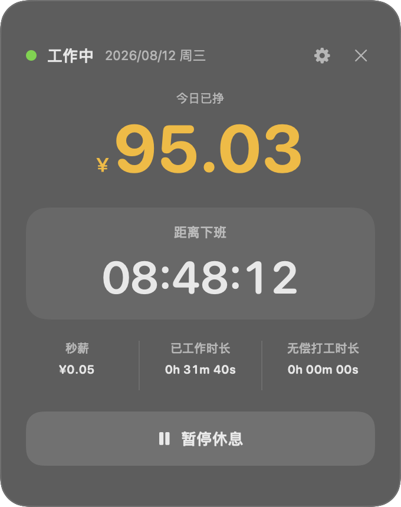
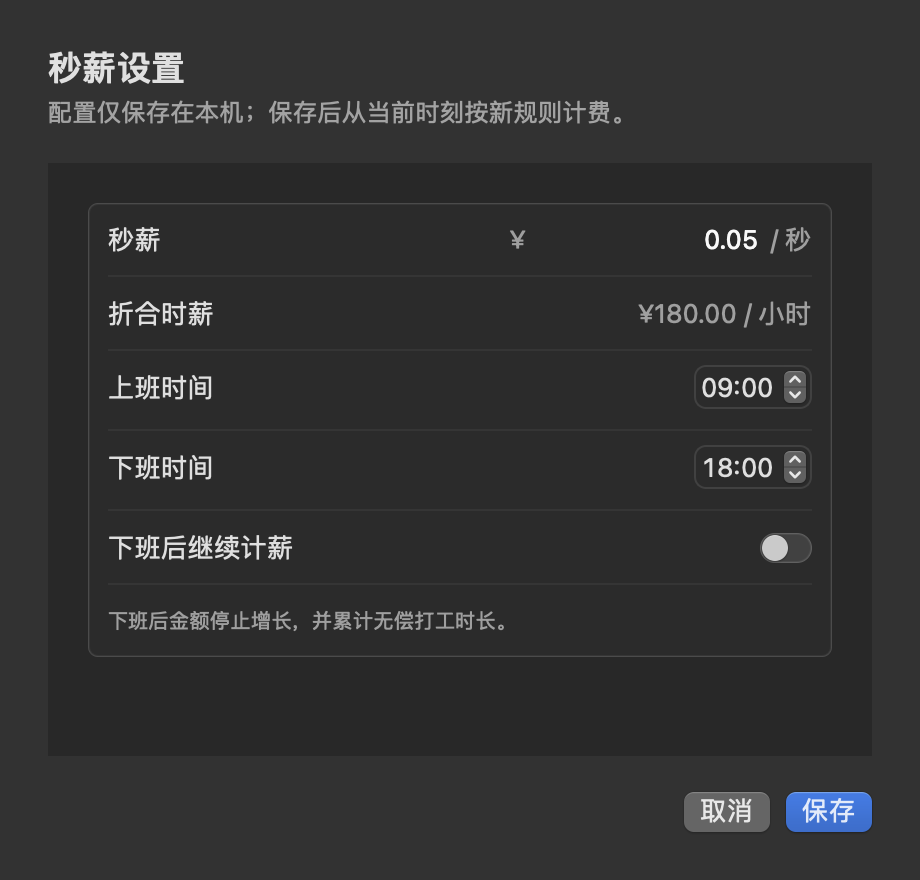

<div align="center">

# Work Income Tracker

### 把工作时间，变成看得见的收入

一款轻量、原生、注重隐私的 macOS 秒薪浮窗应用。

[](https://www.apple.com/macos/)
[](https://www.swift.org/)
[](https://developer.apple.com/xcode/swiftui/)
[](#隐私与数据)

[界面预览](#界面预览) · [功能特性](#功能特性) · [快速开始](#快速开始) · [使用说明](#使用说明) · [开发指南](#开发指南) · [路线图](#路线图)

</div>

---

## 为什么需要它

时间在流逝，但收入增长通常是不可见的。

Work Income Tracker 将当天的工作状态、实时收入、下班倒计时和额外工作时间集中展示在一个低干扰浮窗中，让每一秒工作的价值都清晰可见。

它不会监控键盘、鼠标或工作内容，也不需要账号和网络服务。所有设置和工作记录都保存在你的 Mac 上。

## 界面预览

<div align="center">



**实时工作浮窗**

<br>



**计薪规则设置**

</div>

## 功能特性

### 实时收入

- 按自定义秒薪实时计算当天收入
- 金额精确计算并展示到小数点后两位
- 修改秒薪后仅影响新的工作时段，不改写历史收入

### 工作状态

- 手动切换“工作中”和“休息中”
- 浮窗与菜单栏均可快速操作
- 应用重启后自动恢复未结束的工作状态

### 时间可视化

- 实时下班倒计时
- 当天累计工作时长
- 下班后的无偿打工时长
- 支持普通班次和跨午夜班次

### 灵活的计薪规则

- 自定义上班和下班时间
- 可选择下班后是否继续计薪
- 关闭加班计薪时，下班后自动累计无偿打工时长

### 原生浮窗体验

- 默认停靠在屏幕右下角
- 支持拖动并记忆位置
- 跨 macOS Space 显示
- 多显示器变化后自动回到可见区域
- 深色磨砂玻璃界面

### Local-first

- 无账号
- 无云端依赖
- 无用户行为监控
- 无数据上传

## 界面内容

主浮窗集中展示以下信息：

1. 当天“工作中”或“休息中”状态
2. 当天已挣金额
3. 距离下班时间
4. 当前秒薪
5. 当天已工作时长
6. 无偿打工时长

设置页面支持配置：

- 秒薪
- 上班时间
- 下班时间
- 下班后是否继续计薪

## 系统要求

- macOS 14.0 Sonoma 或更高版本
- Apple Silicon 或 Intel Mac
- Xcode 15.4 或更高版本（仅开发时需要）

## 快速开始

### 直接运行

1. 从项目构建产物或 Release 中获取 `WorkPrice.app`。
2. 将应用拖入“应用程序”文件夹。
3. 双击启动。
4. 从浮窗右上角进入设置并填写秒薪和工作时间。
5. 点击“开始工作”。

> 当前项目尚未进行 Developer ID 签名和公证。若 macOS 阻止首次启动，请在“系统设置 → 隐私与安全性”中确认打开。

### 从源码运行

```bash
git clone git@github.com:ForeverPx/Work-Income-Tracker.git
cd Work-Income-Tracker
open WorkPrice.xcodeproj
```

在 Xcode 中选择 `WorkPrice` Scheme，然后按 `⌘R` 运行。

## 使用说明

### 开始与暂停

- 点击“开始工作”后，应用开始累计工作时长和收入。
- 点击“暂停休息”后，计时与收入暂停。
- 也可以通过菜单栏图标快速切换状态。

### 下班后的计算方式

当“下班后继续计薪”关闭时：

- 当天收入停止增长
- 已工作时长继续增长
- 超出下班时间的部分计入无偿打工时长

当该选项开启时：

- 收入继续增长
- 无偿打工时长保持为零

### 跨午夜班次

当上班时间晚于下班时间时，例如 `22:00–06:00`，应用会自动将其识别为跨午夜班次，并归入班次开始日。

## 计费原则

```text
当天收入 = 有效计薪秒数 × 对应工作时段的秒薪
```

- 计时基于真实时间区间，而不是 Timer 触发次数。
- 系统休眠、应用卡顿或重启不会造成时间漂移。
- 金额使用十进制数计算，避免浮点误差。
- 工作过程中修改配置时，会在修改时刻自动切分记录。

## 开发指南

### 构建 Debug 版本

```bash
xcodebuild \
  -project WorkPrice.xcodeproj \
  -scheme WorkPrice \
  -configuration Debug \
  -destination 'platform=macOS,arch=arm64' \
  build CODE_SIGNING_ALLOWED=NO
```

### 运行测试

```bash
xcodebuild \
  -project WorkPrice.xcodeproj \
  -scheme WorkPrice \
  -destination 'platform=macOS,arch=arm64' \
  test CODE_SIGNING_ALLOWED=NO
```

测试覆盖以下核心场景：

- 开始、暂停和多个工作片段
- 下班临界点和两种加班计薪策略
- 普通班次与跨午夜班次
- 跨日期持续工作
- 夏令时变化
- 应用重启恢复
- 工作中修改秒薪
- 输入校验及金额计算

## 技术栈

- **Swift 5.10**：应用开发语言
- **SwiftUI**：浮窗、设置页和菜单栏界面
- **AppKit / NSPanel**：原生置顶浮窗与多屏幕管理
- **SwiftData**：本地设置和工作记录持久化
- **XCTest**：领域逻辑与状态管理测试

## 项目结构

```text
.
├── WorkPrice.xcodeproj
├── WorkPrice
│   ├── Domain
│   │   ├── PayCalculator.swift
│   │   └── ScheduleResolver.swift
│   ├── Models
│   │   ├── AppSettings.swift
│   │   └── WorkSession.swift
│   ├── State
│   │   └── WorkStateStore.swift
│   ├── Views
│   │   ├── FloatingDashboardView.swift
│   │   └── SettingsView.swift
│   ├── Window
│   │   └── PanelWindowCoordinator.swift
│   └── WorkPriceApp.swift
├── Tests
│   └── WorkPriceTests
└── docs
    └── PRD.md
```

## 架构原则

- **单向状态流**：所有开始、暂停和配置操作由 `WorkStateStore` 统一处理。
- **领域逻辑与 UI 分离**：计薪和班次解析均为可独立测试的纯逻辑。
- **区间计算优先**：通过起止时间重新计算结果，不依赖累计计数器。
- **配置快照**：每个工作片段保存当时的秒薪和计薪策略，避免历史数据被新配置改写。
- **本地优先**：无服务端依赖，离线即可完整使用。

## 隐私与数据

Work Income Tracker 不会收集或上传：

- 键盘和鼠标行为
- 当前应用或窗口信息
- 工作内容
- 身份信息
- 使用统计

应用仅在本机保存秒薪设置和工作时间记录。

## 路线图

- [x] 实时秒薪和工作状态
- [x] 下班倒计时
- [x] 无偿打工时长
- [x] 跨午夜班次
- [x] 本地持久化和重启恢复
- [x] 菜单栏与置顶浮窗
- [ ] 历史日报和周报
- [ ] CSV 数据导出
- [ ] 按星期配置工作时间
- [ ] 节假日与调休
- [ ] 开机自动启动
- [ ] 快捷键和主题配置

## 参与贡献

欢迎提交 Issue 和 Pull Request。

建议贡献流程：

1. Fork 本仓库。
2. 创建功能分支：`git checkout -b feature/your-feature`。
3. 完成功能并补充测试。
4. 确认项目构建和测试通过。
5. 提交 Pull Request，说明改动目的和验证方式。

完整产品需求请参阅 [docs/PRD.md](docs/PRD.md)。

## 许可证

本项目暂未添加开源许可证。在许可证明确前，源代码默认保留所有权利。

---

<div align="center">

如果这个项目对你有帮助，欢迎 Star。

</div>
